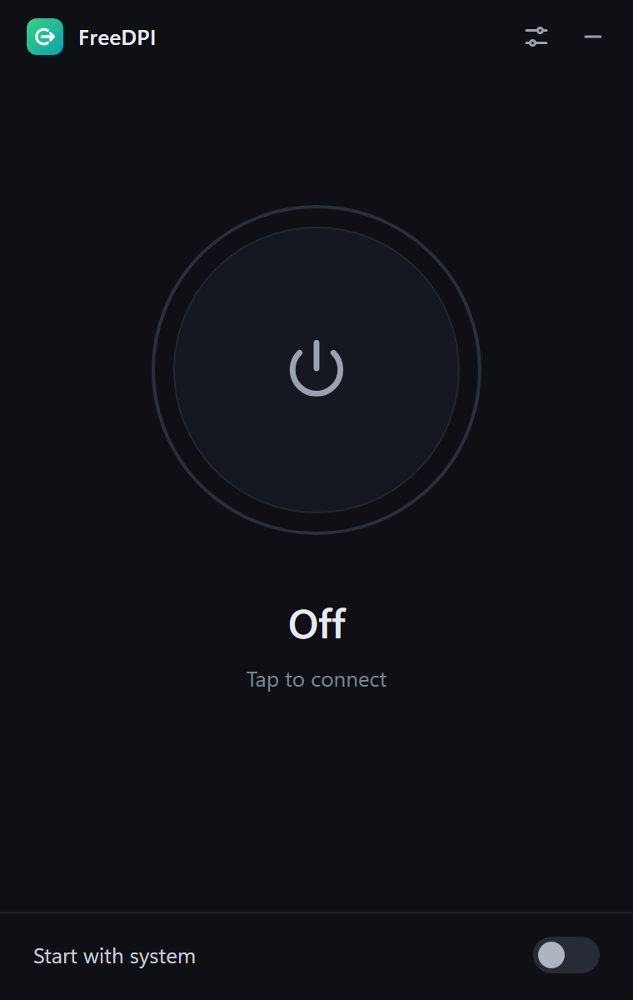
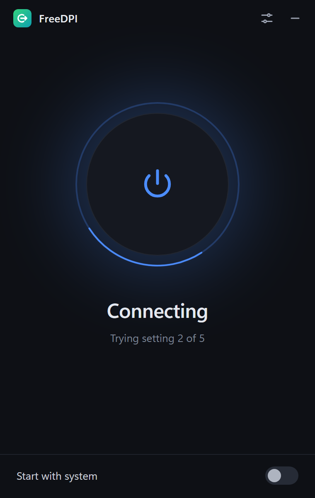
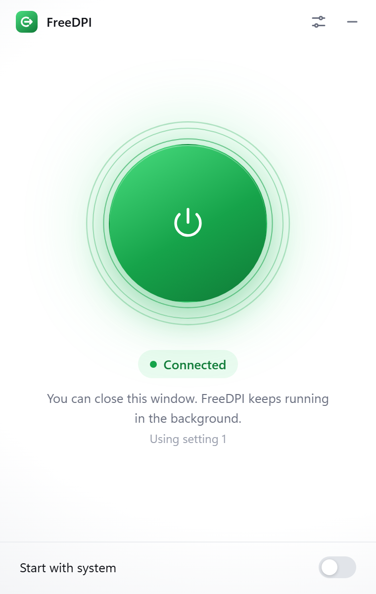
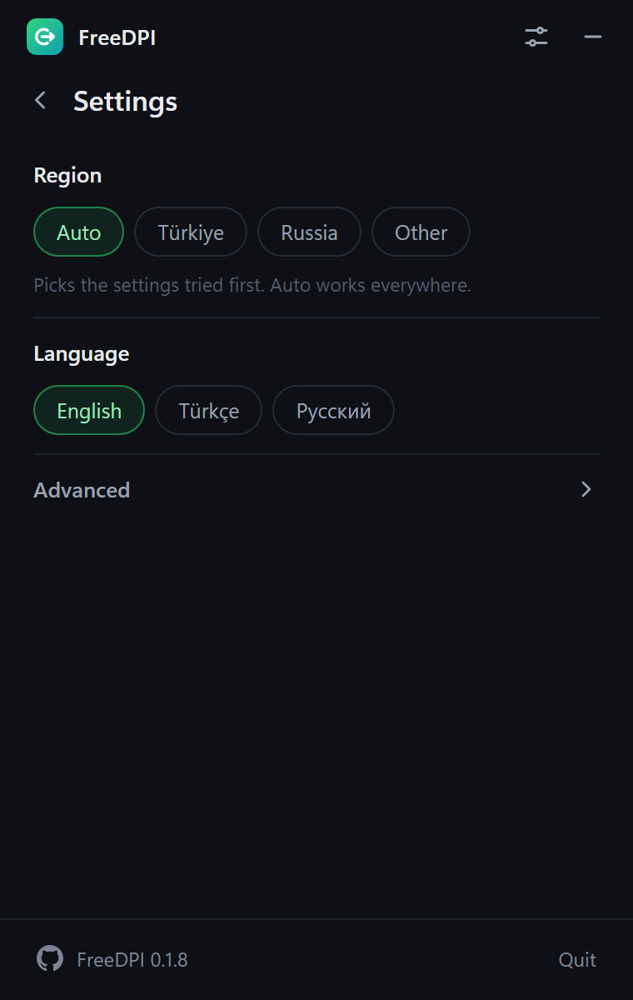

<p align="center">
  
</p>

<h1 align="center">FreeDPI</h1>

<p align="center">
  One-click DPI bypass for Windows and macOS.<br />
  Opens Discord and other sites blocked by your internet provider, without a VPN.
</p>

<p align="center">
  <a href="../../releases/latest"></a>
  
  <a href="LICENSE"></a>
</p>

<p align="center">
  
  
  
</p>

---

## Overview

Many internet providers block websites with Deep Packet Inspection (DPI). The filter reads the name of the site in the first packet your computer sends and cuts the connection when it matches a blocklist.

FreeDPI changes how that first packet is sent so the filter can no longer read it, while your traffic still goes directly to the real server. There is no remote server, no account and no speed loss.

You press one button. FreeDPI tries its built-in settings one by one, checks that the sites you chose really open, and keeps the first one that works. Next time it starts with that setting.

## Features

- **One button.** Finds a working setting for your network automatically.
- **Self-healing.** While connected, FreeDPI checks the connection every 45 seconds and switches to another setting if your provider changes its filter. It also reconnects right after your computer wakes from sleep or joins another network, and shows a notification when the connection drops and when it is back.
- **Runs in the background.** Closing the window keeps FreeDPI running in the system tray on Windows and in the menu bar on macOS. Connect, disconnect, open and quit from the tray menu.
- **Start with system.** Optionally starts when you log in and connects on its own.
- **Works for every site.** FreeDPI is not limited to a list. The test sites under Settings > Advanced are only used to check which setting works on your network, and you can add any domain as a test site.
- **DNS protection.** Name lookups avoid your provider's DNS, so poisoned answers cannot redirect you to a block page.
- **Automatic updates.** New versions are announced inside the app and install with one click. Every update is signed and verified before it is installed.
- **Installer.** Start menu and desktop shortcuts on Windows, a standard app bundle on macOS, and a clean uninstaller.
- **English, Turkish and Russian** interface, chosen automatically from your system language.
- **Light and dark theme.** Follows your system setting by default, or pick one under Settings > Theme.

## Supported

| | |
| --- | --- |
| **Windows** | Windows 10 and 11, 64-bit |
| **macOS** | macOS 11 Big Sur or later, Apple Silicon and Intel |
| **Sites** | Every site. Discord, YouTube, Roblox and Wattpad are built-in test sites, and you can add your own |
| **Regions** | Auto, Türkiye, Russia, Other |
| **Languages** | English, Türkçe, Русский |

FreeDPI has been tested on Turkish providers, including Superonline. Other providers and countries are supported through the general setting list. If FreeDPI does not work on your network, please [open an issue](../../issues) and mention your country and provider.

<p align="center">
  
</p>

## Install

Download the latest version from [Releases](../../releases/latest).

### Windows

1. Download `FreeDPI_x.y.z_x64-setup.exe` and run it.
2. If Windows SmartScreen shows "Windows protected your PC", click **More info** and then **Run anyway**. This appears because the app is not code-signed yet.
3. Open FreeDPI from the Start menu or the desktop shortcut. It asks for administrator permission once at launch, which the network driver needs.

### macOS

1. Download `FreeDPI_x.y.z_universal.dmg`, open it and drag FreeDPI into Applications.
2. The first time you open it, macOS says the developer cannot be verified. Open **System Settings > Privacy & Security** and click **Open Anyway**. This appears because the app is not notarized yet.
3. Connect with the power button. macOS may ask for your password once so FreeDPI can set the system proxy.

## macOS notes

**Keystroke permission prompt.** macOS may show a dialog saying FreeDPI wants to receive keystrokes from any application. Click **Deny**. FreeDPI never reads your keyboard and does not need this permission. The prompt is triggered by the desktop framework the app is built on, not by FreeDPI itself. Denying it does not affect any feature, and macOS stops asking after you deny it.

**Open FreeDPI before Discord.** On macOS, FreeDPI works through the system proxy, so apps pick it up when they start. Connect FreeDPI first and then open Discord. If Discord was already open, use the **Open Discord with FreeDPI** button in the app, or quit Discord and open it again. Turning on **Start with system** makes this automatic after a restart.

## Settings

**Region** decides which settings are tried first. Auto tries all of them and works everywhere, so you only need to change it if connecting takes long.

**Test sites**, under **Advanced**, are the sites FreeDPI opens to confirm that a setting works. They do not limit what gets unblocked: once connected, FreeDPI works for every site. Turn on the sites you care about most, and add a domain if a site you use is blocked but not in the list.

**Only test sites**, also under **Advanced**, applies the bypass only to the test sites and their related domains. The rest of your traffic is left completely untouched. Blocked sites that are not in the list will not open while this is on. It is off by default.

**Help**, also under **Advanced**, has a button that copies diagnostics (version, settings, status and recent log lines, with no personal data) and a button that opens a new issue on GitHub.

**Language** switches between English, Turkish and Russian.

The GitHub icon at the bottom of Settings opens this repository.

## Antivirus warnings

A few antivirus engines may flag the Windows installer. On VirusTotal, version 0.1.5 was flagged by 2 of 71 engines, both machine-learning based (SecureAge and Trapmine). Major engines such as Microsoft Defender, Kaspersky, BitDefender, ESET and Avast reported it as clean.

This is a false positive. Machine-learning scanners judge files by how they look rather than by known threats, and the FreeDPI installer has several traits they weigh as risky:

- It is a new file with no reputation yet, and every release produces a new one.
- It is an installer that unpacks other programs, including a network driver, and asks for administrator rights.
- It is not code-signed yet.

The full source code is in this repository, and the bundled third-party binaries are listed with their checksums in [third_party](third_party/README.md), so you can verify everything yourself. Code signing is planned and should remove most of these warnings.

## How it works

| | Windows | macOS |
| --- | --- | --- |
| Engine | [GoodbyeDPI](https://github.com/ValdikSS/GoodbyeDPI) with the WinDivert driver | Built-in engine written in Rust |
| Scope | All apps, transparently | Apps that use the system proxy, including browsers and Discord |
| DNS | Redirected to a resolver on a non-standard port | DNS over HTTPS through Cloudflare and Google |
| Permissions | Administrator, once at launch | Your password, once, to set the system proxy |

The macOS engine runs a local proxy on `127.0.0.1:18080`. It splits the first TLS packet (the ClientHello) into several TCP segments or TLS records, so the site name never appears in one piece, and it can send the first segment out of order. The same engine is covered by tests on both platforms in CI.

## Privacy

FreeDPI has no accounts, analytics or telemetry. It only connects to:

- the sites you selected, to check that they open,
- Cloudflare and Google DNS over HTTPS on macOS, to look up site addresses,
- GitHub, to check for new versions.

FreeDPI is not a VPN. It does not hide your IP address or encrypt your traffic beyond what the sites themselves already do.

## Troubleshooting

**"No setting worked on this network."** Check that your internet connection works, then try again. Choosing your region in Settings can help. If one of your test sites is down or not blocked for a different reason, turn it off and connect again. If it still fails, open an issue with your country and provider.

**Windows: nothing works and Kaspersky is installed.** Kaspersky blocks the WinDivert network driver. Uninstalling Kaspersky completely is required. Disabling it is not enough.

**macOS: a site opens in the browser but not in an app.** The app was probably started before FreeDPI connected. Quit the app and open it again.

**Discord voice channels.** Discord voice uses UDP. On Windows it goes through the same network driver; on macOS the system proxy only carries TCP, so voice traffic is not handled by FreeDPI there. If text chat works but voice does not, please open an issue with your provider.

**Log files.** FreeDPI writes a log to `%LOCALAPPDATA%\com.freedpi.desktop\logs` on Windows and `~/Library/Logs/com.freedpi.desktop` on macOS. The Copy diagnostics button includes the most recent lines.

**Removing all data.** The Windows uninstaller has a "Delete the application data" checkbox that also removes settings and logs.

**Another DPI tool is running.** Close GoodbyeDPI, zapret or similar tools before connecting. FreeDPI stops an old GoodbyeDPI service automatically on Windows.

## Status and bug reports

FreeDPI is under active development. Bugs are fixed as they are reported, and fixes reach you through the automatic updater. If something does not work, please [open an issue](../../issues) with:

- your operating system and FreeDPI version (shown next to the GitHub icon at the bottom of Settings),
- your country and internet provider,
- what you expected and what happened,
- the output of **Settings > Advanced > Copy diagnostics**.

Planned next: code signing for Windows and macOS, and an Android version.

## Changelog

See [CHANGELOG.md](CHANGELOG.md). The notes for each version are also shown in the app when an update is available.

## Build from source

Requirements: Node.js 22 or later, Rust stable, and the [Tauri prerequisites](https://tauri.app/start/prerequisites/) for your operating system.

```
npm install
npm run tauri dev
```

Run the tests:

```
cargo test --manifest-path src-tauri/Cargo.toml
```

Debug builds on Windows do not request administrator rights, so the engine only starts in a release build or from an elevated terminal. Release installers are built by GitHub Actions.

### Project layout

```
src/                     User interface (TypeScript, no framework)
src-tauri/src/
  controller.rs          Connect, disconnect and self-healing logic
  catalog.rs             Regions, setting lists and test sites
  probe.rs               Checks whether the selected sites open
  network.rs             Sleep and network change detection
  log.rs                 Log file and diagnostics
  tray.rs                Tray icon and menu
  autostart.rs           Start with system (Task Scheduler, LaunchAgent)
  updater.rs             Signed automatic updates
  engine/driver.rs       Windows engine (GoodbyeDPI)
  engine/proxy/          Cross-platform proxy engine (TLS split, DNS over HTTPS)
  engine/sysproxy.rs     macOS system proxy
src-tauri/resources/     Bundled GoodbyeDPI and WinDivert binaries for Windows
third_party/             Licenses and checksums of bundled components
docs/screenshots/        Images used in this README
```

## Disclaimer

FreeDPI is a general-purpose networking tool made for education, research and personal use. It changes how your own computer sends its packets. It does not host, provide or distribute any content, and it does not route your traffic through any third-party server.

You are responsible for how you use FreeDPI and for following the laws and regulations that apply where you live. The authors do not encourage any use that breaks local law.

FreeDPI is provided "as is", without warranty of any kind, as described in the GNU General Public License v3.0. The authors are not liable for any damage or legal consequence arising from its use.

## License

FreeDPI is released under the [GNU General Public License v3.0](LICENSE).

Bundled third-party components keep their own licenses. See [third_party](third_party/README.md) for details and checksums.

FreeDPI is an independent project and is not affiliated with GoodbyeDPI or its authors. Thanks to [GoodbyeDPI](https://github.com/ValdikSS/GoodbyeDPI) and [WinDivert](https://github.com/basil00/WinDivert), which power the Windows engine.
